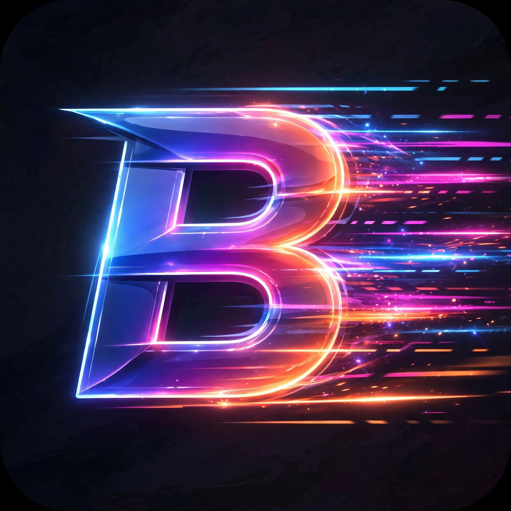

  

# BlurRecomp

**A native macOS (Apple Silicon) port of *Blur* (Xbox 360, 2010) via static recompilation.**

By [AbadXDev](https://github.com/AbadXDev).

> 🚧 **Work in progress — not playable yet.** This repository tracks the project's progress. The source code will be published here when the game renders its first frames.

## Status (2026-11-17)

- ✅ Original game image verified and extracted (Title ID `41560845`)
- ✅ Full PPC → C++ recompilation: 76,019 functions, native arm64 build
- ✅ The game **boots natively on macOS**: kernel phase reaches Runtime, all boot packages mount (`root`, `root_streaming`, `shaders-speed`, `gamedata`)
- ✅ Xenos PM4 command stream decoded (hardware ring + indirect buffers) and executed on the host (CP executor with fence/flip protocol)
- ✅ Frame loop running at **~90 fps** presenting frames, no GPU hangs
- 🔄 In progress: the engine stalls after the boot packages — scene loading never starts, so nothing is drawn yet
- ⬜ Draw execution on the host GPU (DRAW_INDX / IM_LOAD)
- ⬜ Xenos shader microcode translation
- ⬜ Input, audio, save data

## What is this?

*Blur* never received a native Mac port. BlurRecomp recompiles the original Xbox 360 executable into native C++ (the same approach as Unleashed Recompiled and other XenonRecomp/ReXGlue projects) and pairs it with a host runtime for graphics, audio and input — so the game can run natively on Apple Silicon without emulation.

## Requirements

- A Mac with Apple Silicon
- **Your own legally obtained copy of *Blur* for Xbox 360** (Games on Demand image). No game assets are included in this repository or distributed with the app, and none ever will be.

## Roadmap

1. ~~Boot to a stable frame loop~~ ✅
2. First rendered frame from the game's own draw stream
3. Title screen
4. Menus and car select
5. In-race gameplay
6. Audio, saves and polish
7. Public release build

## Credits

Built on the Xbox 360 recompilation ecosystem (XenonRecomp / ReXGlue) and informed by the community's work on Marathon/Unleashed Recompiled. *Blur* © Activision / Bizarre Creations. This is a non-commercial, fan-made preservation project.

## License

MIT
